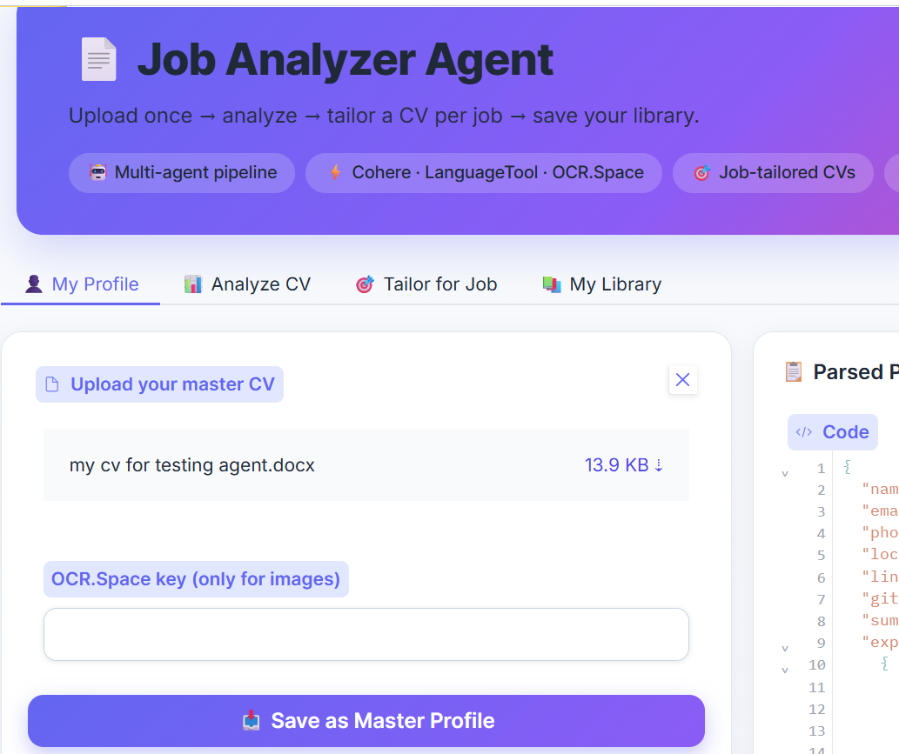
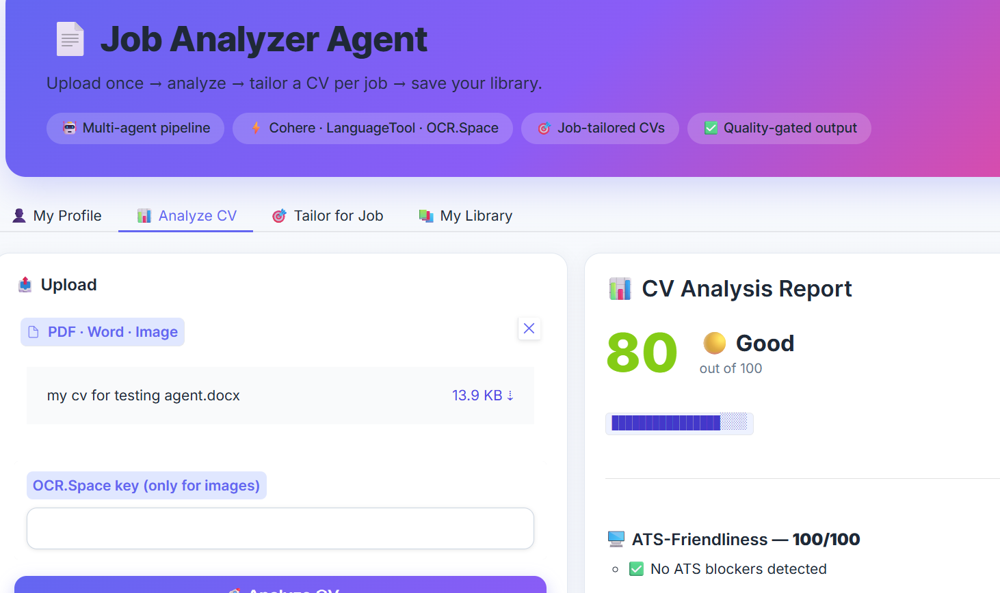
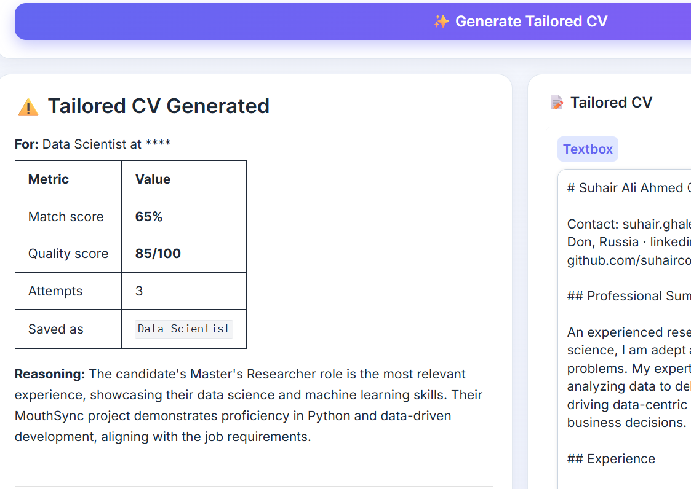
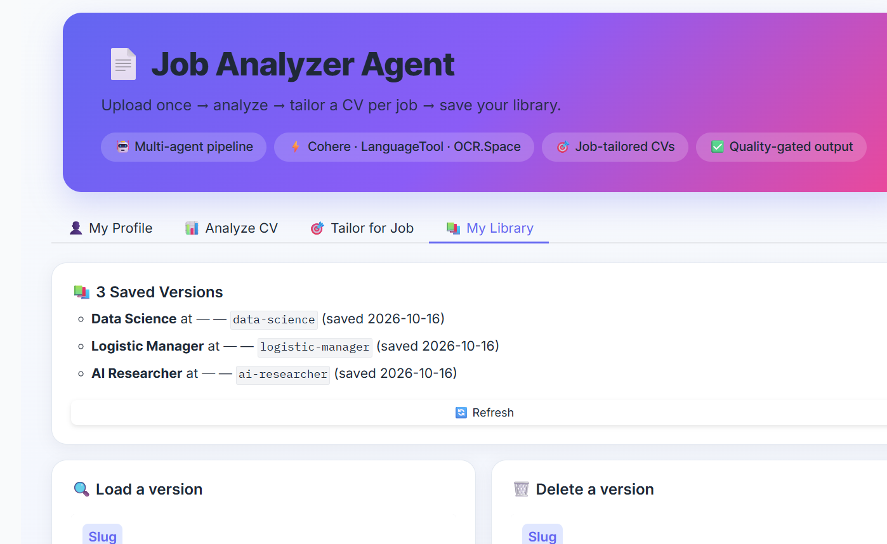

<div align="center">

# 📄 Job Analyzer Agent

**Upload once → analyze → tailor a CV per job → save your library.**

A multi-agent AI system that parses your master CV, analyzes any job description, generates a tailored CV per job, and validates every output with a quality gate.

[](https://www.python.org/)
[](https://gradio.app/)
[](https://cohere.com/)
[](LICENSE)

[Features](#-features) · [Demo](#-demo) · [Quick Start](#-quick-start) · [How It Works](#-how-it-works) · [Roadmap](#-roadmap)

</div>

---

## ✨ Features

### 🆕 v2.0 — Multi-CV Tailoring

- **👤 My Profile** — Upload your CV once. It's parsed into structured JSON and saved as your master profile.
- **🎯 Tailor for Job** — Paste any job description. A 3-stage agent pipeline generates a CV tailored to that specific role.
- **📚 My Library** — Browse every tailored CV you've generated, load any of them, or delete old ones.
- **✅ Quality Gate** — Every generated CV is validated for hallucinations, length, sections, and clichés. If it fails, the system retries with feedback — up to 3 times.

### v1.0 — Foundation

- **📊 Analyze CV** — Grammar & spelling, missing sections, ATS-friendliness, weighted quality score
- **🤖 AI Feedback** — Prioritized, actionable suggestions
- **🧐 Recruiter Critique** — Impact, tone, storytelling — what a hiring manager notices
- **📂 Multi-format** — Reads PDF, Word (`.docx`), and images (via OCR)

---

## 🖼 Demo

<table>
  <tr>
    <td width="50%">
      
      <p align="center"><em>👤 My Profile — CV parsed into structured JSON</em></p>
    </td>
    <td width="50%">
      
      <p align="center"><em>📊 Analyze — score, ATS check, grammar</em></p>
    </td>
  </tr>
  <tr>
    <td width="50%">
      
      <p align="center"><em>🎯 Tailor for Job — job-specific CV + quality score</em></p>
    </td>
    <td width="50%">
      
      <p align="center"><em>📚 My Library — every tailored version you've saved</em></p>
    </td>
  </tr>
</table>

---

## 🚀 Quick Start

### 1. Clone the repo

```bash
git clone https://github.com/suhaircoder/job-analyzer-agent.git
cd job-analyzer-agent